  

  
  
  
  

---

<table>
<tr>
<td width="50%" valign="top">

### 🟣 `engineer`

Back-end and data engineer at **[Solrus](https://www.solrus.pro)**, a software studio in Algiers.
I design the data models, APIs and integrations that let a product grow without a rewrite.

- Event-driven Python services: FastAPI, SQLAlchemy 2, Kafka, Redis
- Security from the start: RBAC, 2FA, audit trails, data residency
- Test-first: pytest on real PostgreSQL, Playwright end to end

</td>
<td width="50%" valign="top">

### 🟪 `educator`

Teaching Assistant at **Université M'Hamed Bougara** (Boumerdès).
12 subjects so far, Bachelor's and Master's level.

- Algorithms & data structures, databases
- Programming languages, compilation, semantics
- Former Development Mentor at the DevUp club

</td>
</tr>
</table>

## ✦ Open work

| Project | What it does | Stack |
|---|---|---|
| **[DocMCP](https://github.com/V0idSeeker/RAG-MCP)** | Local PDF search for AI coding tools over MCP, with Recursive Language Model reasoning. Nothing leaves the machine. | Python · Node.js · ChromaDB · Ollama · Docker |
| **[VoidSketches](https://voidsketches.vercel.app)** | Free computer-science lessons explained through real-life analogies: one concept per animated, narrated lesson, in English and French. No account, no paywall. | React · Vite · local TTS · Vercel |
| **[Portfolio](https://github.com/V0idSeeker/rezki-boureghdad)** | My portfolio and CV: one page that switches between an engineer and an educator view. | HTML · CSS · Motion |

> Most of my production work is client software at Solrus. It lives in private repos and is covered by NDAs.

## ✦ Stack

  
  
  
  
  
  
  
  
  
  
  
  
  

Arabic · French · English (C2) — Algiers, Algeria

